# RakshaLogix

> Tactical Forward-Logistics Command, Control & Predictive AI Decision Support for High-Altitude Military Operations

[](#)
[](#)
[](#)
[](#)
[](#)
[](#)
[](LICENSE)

[Live Demo](#) <!-- Replace with deployed Vercel URL -->

---

## Operational Interface

| Dark Mode (Tactical Night Ops // Default) | Light Mode (High-Albedo Snow Glare // Contrast) |
| :---: | :---: |
| 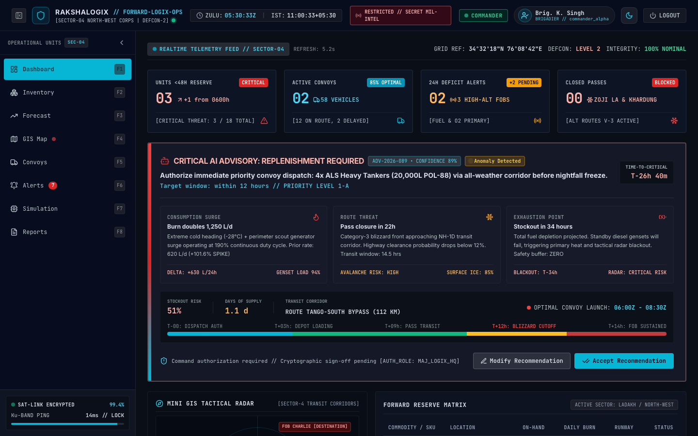 | 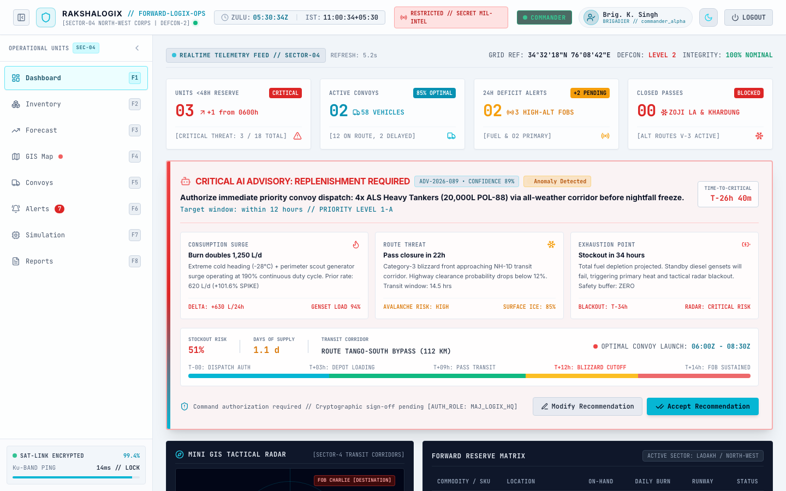 |

---

## 1. Problem Statement

Developed for **Hackathon Problem Statement PS-26251 (Predictive Logistics for Forward Areas)**:

Forward deployment sectors in rugged high-altitude theaters (such as Ladakh, Siachen, and Sub-Sector North) face critical supply chain vulnerabilities:
- **Severe Weather & Unpredictable Mountain Pass Closures**: Avalanches, blizzards, and sub-zero temperatures (-20°C to -40°C) routinely choke strategic mountain passes (e.g., Zoji La, Khardung La).
- **Sub-zero Consumption Spikes**: Unscheduled kerosene/diesel (POL) and medical burn rates during arctic snaps deplete outposts faster than standard run-rates anticipate.
- **Stockout Crises**: Delayed or cut-off convoys lead to zero-stockout emergencies at isolated forward operating bases (FOBs).

### The RakshaLogix Solution
**RakshaLogix** provides an integrated Command and Control (C2) situational awareness and predictive logistics dashboard. It unifies real-time forward depot telemetry, probabilistic consumption forecasting, automated A* transit corridor optimization with weather-bypass fallback corridors, scenario stress testing, and human-in-the-loop convoy dispatch.

---

## 2. Key Features

- **Human-in-the-Loop AI Decision-Support**: Autonomous models propose actionable recommendations with quantified confidence scores and underlying risk factors, but **never execute dispatches autonomously**. Officers retain final operational authority to accept, modify, or dismiss.
- **Probabilistic Demand Forecasting ($p_{10}, p_{50}, p_{90}$)**: Multi-horizon quantile forecasting (24h, 48h, 7d) capturing upper-bound surge risks rather than single deterministic averages.
- **Stockout Risk & Runway Tracking**: Dynamic Days-of-Supply (DoS) computations and real-time probability of stock exhaustion.
- **Automated Anomaly Detection**: Flags unusual consumption burn surges caused by extreme weather drops or operational drills.
- **GIS Route Optimization & Fallback Corridors**: Interactive Leaflet tactical map rendering A* primary corridors and alternative bypass axes when high-altitude passes freeze or are interdicted.
- **Convoy Fleet Management**: Dispatch scheduling, asset allocation, cargo manifest tracking, and real-time time-to-arrival (ETA) countdowns.
- **Alerts Management with Acknowledgment**: Severity-tiered deficit and pass-closure alerts with cryptographic officer sign-off.
- **What-If Simulation Lab**: Dynamic scenario modeling (demand multipliers, snowfall depth deltas, and pass cutoff toggles) with live comparative trajectory curves.
- **Tamper-Evident Audit Trail**: Immutable logging of every operational decision, timestamped in both UTC (Zulu) and Indian Standard Time (IST).
- **Role-Based Access Control (RBAC)**: Distinct military operational clearances (`CORPS_COMMANDER`, `LOGISTICS_OFFICER`, and `EDGE_READ_ONLY`) with strict UI gating and backend token verification.
- **Dual Visual Themes**: Seamless switching between ruggedized Dark Glass HUD (night combat) and High-Contrast Light Glass (snow glare environments).
- **Tactical Collapsible Sidebar**: Smooth transition between full navigation (~280px with F-key shortcuts) and compact icon mode (~72px), auto-collapsing below 1024px width with `Ctrl+B` / `Cmd+B` shortcut and automatic map size invalidation.

---

## 3. Screenshots Gallery

| Screen | Dark Mode | Light Mode |
| :--- | :---: | :---: |
| **Authentication Terminal** | 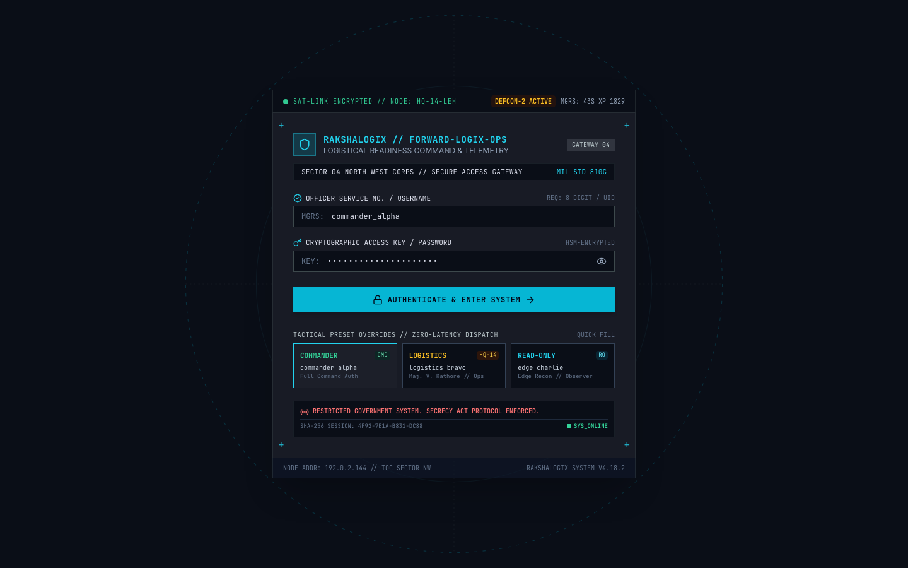 | — |
| **Command Dashboard** |  |  |
| **Forward Inventory Matrix** | 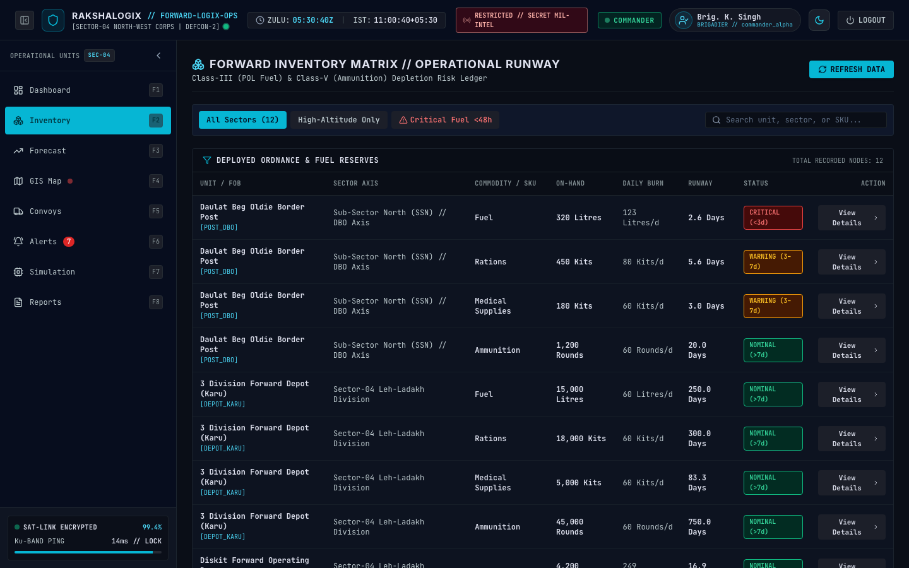 | — |
| **Probabilistic Forecast Explorer** | 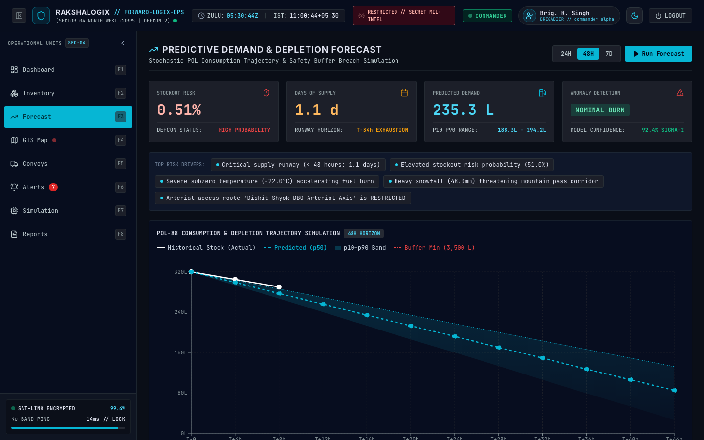 | 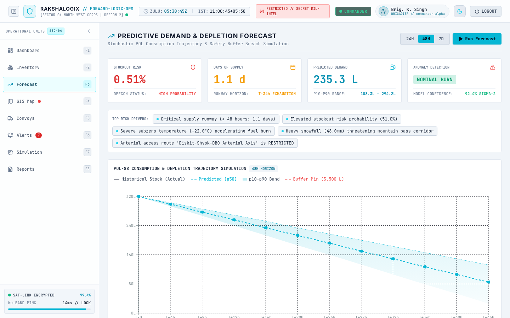 |
| **GIS Tactical Map & Corridors** | 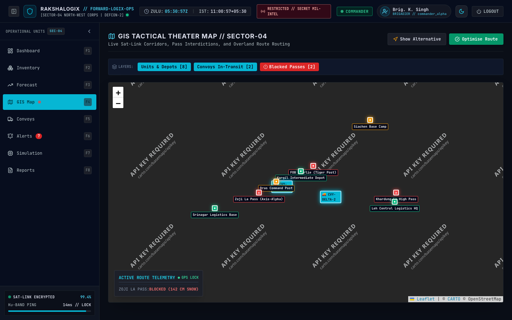 | 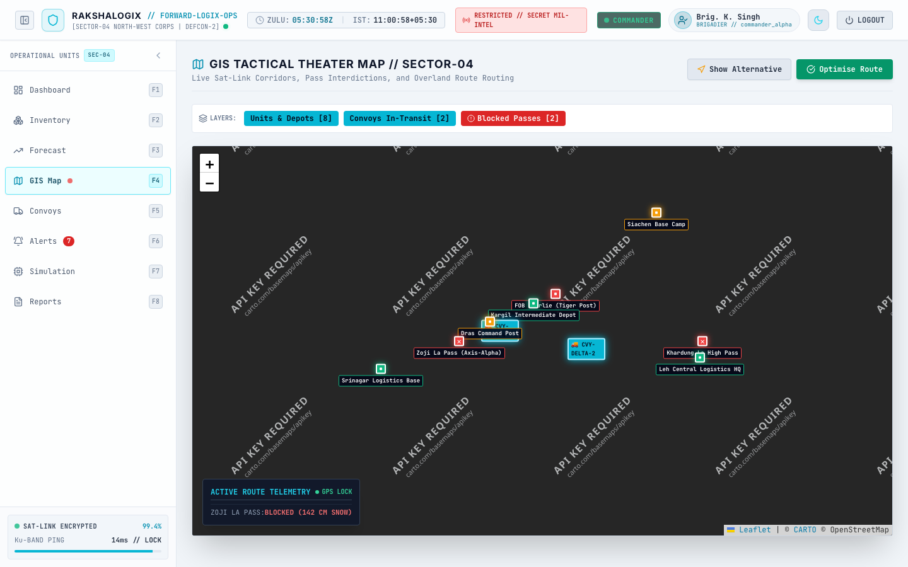 |
| **Convoy Dispatch Hub** | 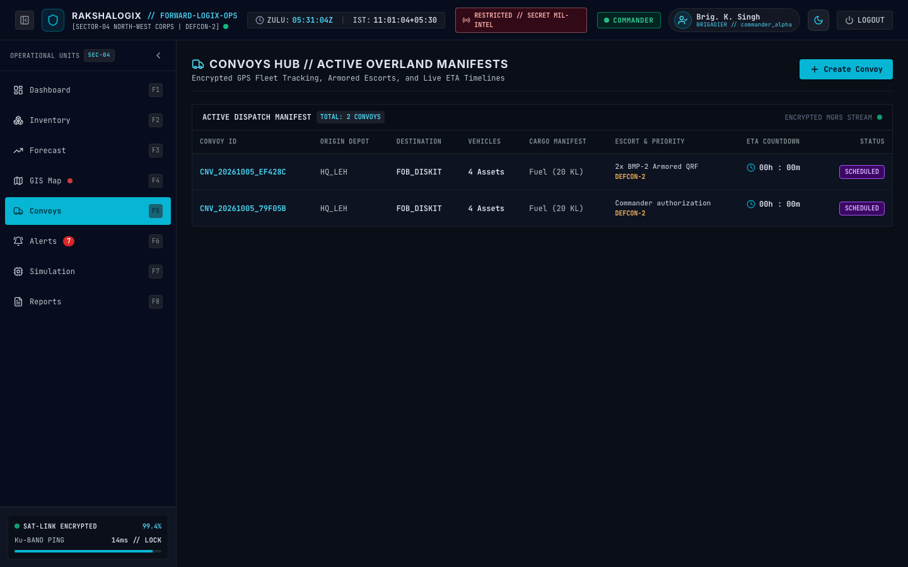 | — |
| **Threat & Deficit Alerts** | 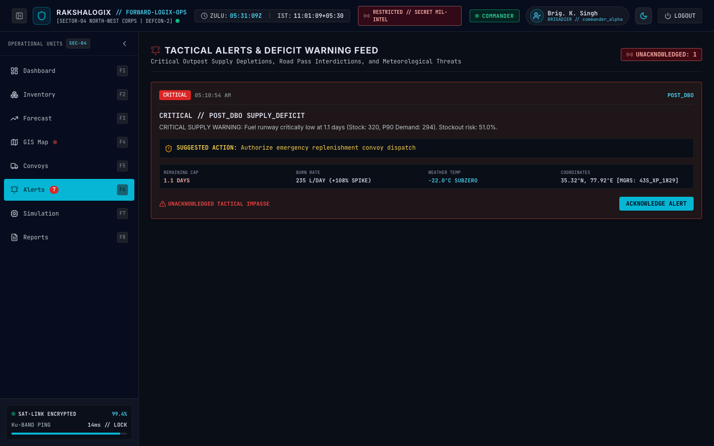 | — |
| **What-If Simulation Lab** | 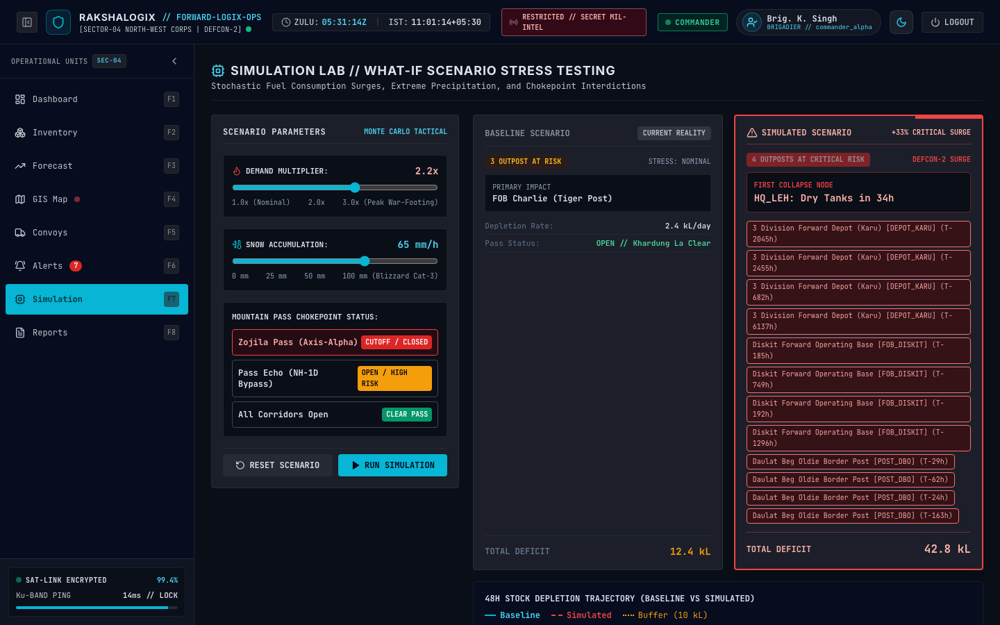 | — |
| **Audit Dossier & Reports** | 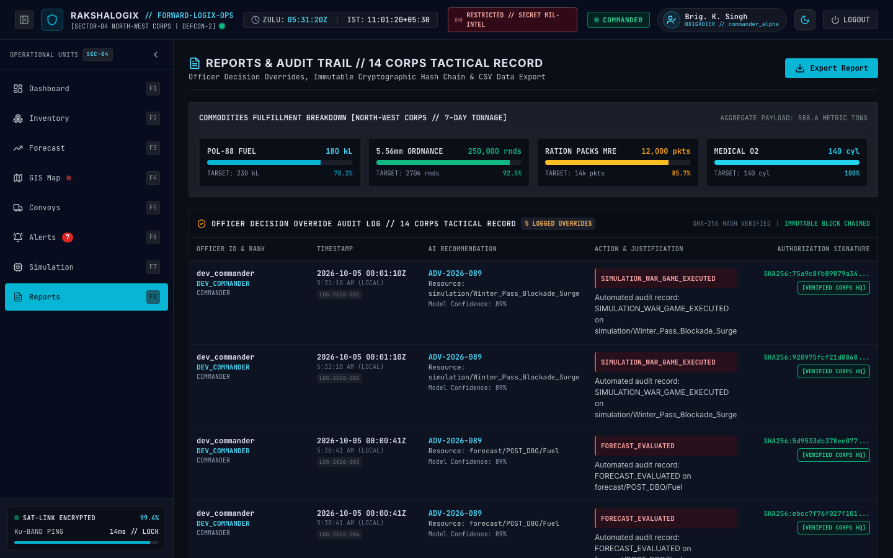 | — |

---

## 4. System Architecture

> **Note**: The FastAPI backend services, ML inference pipelines, and PostGIS database are maintained in a separate repository by backend and data science teammates.

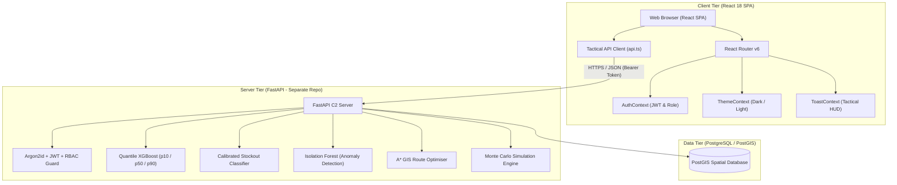

---

## 5. Frontend Component & Data Flow

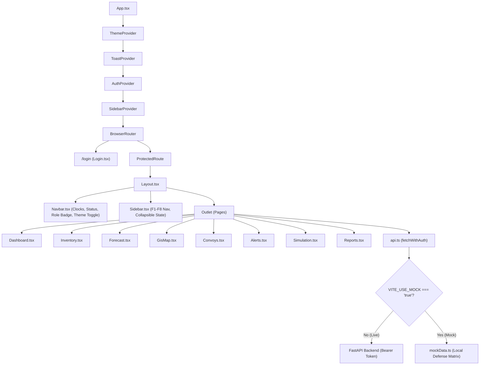

---

## 6. Authentication & RBAC Flow

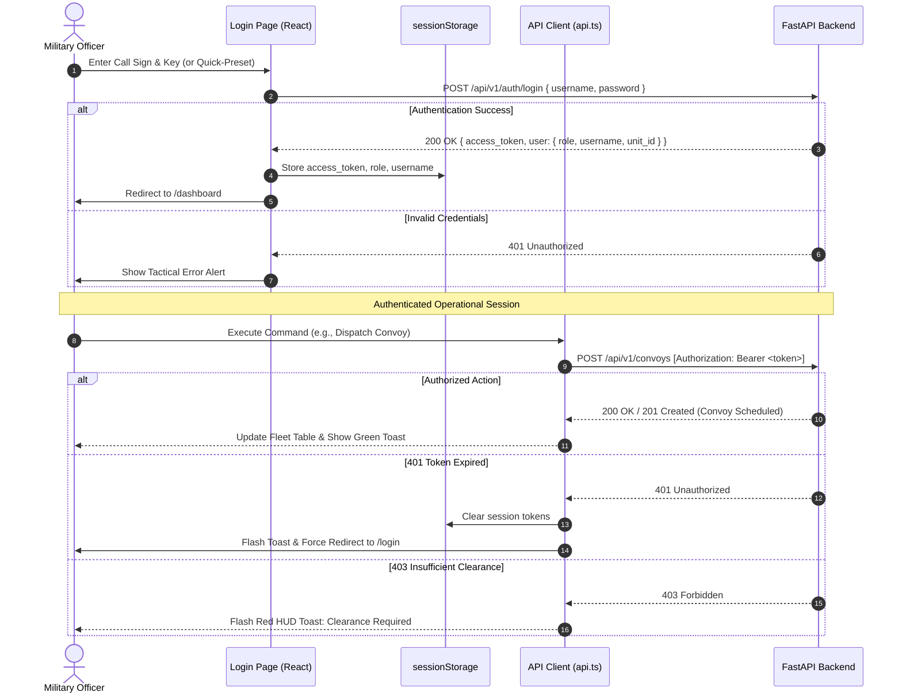

### Role Permissions Matrix

| Operational Capability | `CORPS_COMMANDER` | `LOGISTICS_OFFICER` | `EDGE_READ_ONLY` |
| :--- | :---: | :---: | :---: |
| **View Dashboards & Telemetry** | Full | Full | Full |
| **Inspect Inventory Matrix & Depletion Curves** | Full | Full | Full |
| **Generate Forecasts (24h / 48h / 7d)** | Full | Full | Full |
| **Inspect GIS Tactical Map & Alternate Corridors** | Full | Full | Full |
| **Accept AI Advisory Recommendation** | Enabled | Enabled | Disabled (View Only) |
| **Schedule & Dispatch Tactical Convoys** | Enabled | Enabled | Disabled (View Only) |
| **Acknowledge Sector Threat Alerts** | Enabled | Enabled | Disabled (View Only) |
| **Run What-If Scenario Simulations** | Enabled | Enabled | Enabled |
| **Export Audit Logs (CSV)** | Full | Full | Full |

> **Important**: UI element masking (disabled buttons, warning badges) is provided for tactical workflow ergonomics. Security guarantees and authorization restrictions are strictly enforced server-side via FastAPI JWT scopes.

---

## 7. Human-in-the-Loop Decision Flow

RakshaLogix strictly enforces an operational doctrine where AI assists but **never executes commands autonomously**:

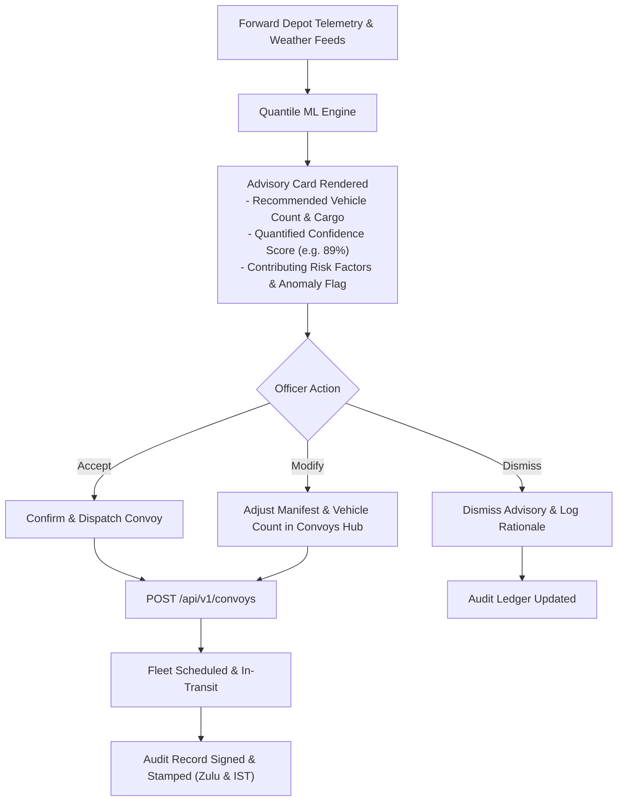

---

## 8. Button to API Endpoint Mapping

All actions in the frontend wire directly to standardized endpoints:

| Interface Location | UI Button / Action Trigger | HTTP Method | Target Endpoint | Description |
| :--- | :--- | :---: | :--- | :--- |
| **Login** | `AUTHENTICATE & ENTER SYSTEM` | `POST` | `/api/v1/auth/login` | Authenticates officer and receives bearer token |
| **Dashboard** | `CONFIRM & DISPATCH CONVOY` | `POST` | `/api/v1/convoys` | Directly accepts AI advisory and dispatches convoy |
| **Dashboard** | `DISMISS REVISE ADVISORY` | Client | N/A | Dismisses advisory card from active dashboard view |
| **Dashboard** | `MODIFY PARAMETERS` | Client | Route `/convoys` | Navigates to convoy scheduler with advisory pre-fills |
| **Inventory** | Unit Row Click | `GET` | `/api/v1/inventory/{unit_id}` | Fetches stock summary, burn ledger, and altitude metrics |
| **Inventory** | `DISPATCH REPLENISHMENT` | Client | Route `/convoys` | Navigates to convoy form with target depot pre-selected |
| **Forecast** | `24 HOURS` / `48 HOURS` / `7 DAYS` | `POST` | `/api/v1/forecast` | Requests quantile forecast curve and risk metrics |
| **GIS Map** | `COMPUTE A* OPTIMAL ROUTE` | `POST` | `/api/v1/routes/optimise` | Runs spatial A* routing avoiding blocked passes |
| **GIS Map** | `QUERY WEATHER-BYPASS CORRIDOR` | `GET` | `/api/v1/routes/{id}/fallback` | Retrieves secondary mountain pass fallback corridor |
| **Convoys** | `SCHEDULE & DISPATCH CONVOY` | `POST` | `/api/v1/convoys` | Creates and activates forward logistics convoy |
| **Alerts** | `ACKNOWLEDGE & LOG ACTION` | `PATCH` | `/api/v1/alerts/{id}/ack` | Acknowledges threat/deficit alert with officer notes |
| **Simulation** | `EXECUTE PREDICTIVE MONTE-CARLO STRESS SIMULATION` | `POST` | `/api/v1/simulation/scenario` | Executes what-if weather and surge stress simulation |
| **Reports** | `EXPORT CSV DOSSIER` | `GET` | `/api/v1/reports/export.csv` | Downloads CSV audit log (with client-side fallback) |

---

## 9. Tech Stack & Project Structure

### Tech Stack
| Layer | Technologies |
| :--- | :--- |
| **Framework & Build** | React 18.3, TypeScript 5.5, Vite 5.4 |
| **Styling & Design System** | Tailwind CSS 3.4 (Tactical Vanguard Palette, Dark/Light mode tokens) |
| **Iconography** | Lucide React (Tactical SVGs, zero remote external dependencies) |
| **GIS & Mapping** | Leaflet 1.9, React-Leaflet 4.2, CartoDB Dark/Voyager tile providers |
| **Data Visualization** | Recharts 2.12 (AreaChart, ResponsiveContainer, quantile bounds) |
| **Routing & Auth** | React Router DOM v6, JWT-based SessionStorage token store |
| **Testing & CI** | Playwright (automated screen captures), Oxlint (Rust-based linter) |

### Directory Structure

```text
app/
├── public/
│   ├── favicon.svg              # Tactical insignia favicon
│   └── icons.svg                # Military symbology vector sprite
├── src/
│   ├── api.ts                   # Unified API client with fetchWithAuth & cold-start handler
│   ├── App.css                  # Tactical layout utilities & scrollbar styling
│   ├── App.tsx                  # Root application router & providers wrapper
│   ├── index.css                # Tailwind directives & CSS custom property tokens
│   ├── main.tsx                 # React entry point
│   ├── assets/                  # Local vector assets
│   ├── components/
│   │   ├── Layout.tsx           # Flexbox C2 layout shell with min-w-0 main container
│   │   ├── Navbar.tsx           # Telemetry header (Zulu/IST, classification, role, theme)
│   │   ├── ProtectedRoute.tsx   # Authentication route guard
│   │   ├── ServerLoader.tsx     # Render cold-start indicator (60s timer animation)
│   │   └── Sidebar.tsx          # Tactical collapsible navigation matrix (~280px / ~72px)
│   ├── context/
│   │   ├── AuthContext.tsx      # Military session state & RBAC user profiles
│   │   ├── SidebarContext.tsx   # Sidebar collapse state with localStorage & Ctrl+B hotkey
│   │   ├── ThemeContext.tsx     # Dark / Light theme toggle with document root sync
│   │   └── ToastContext.tsx     # HUD notification system for warnings and approvals
│   ├── pages/
│   │   ├── Alerts.tsx           # Deficit alerts hub with acknowledgment workflow
│   │   ├── Convoys.tsx          # Convoy dispatch scheduler & fleet tracker
│   │   ├── Dashboard.tsx        # High-level C2 readiness index & AI advisory card
│   │   ├── Forecast.tsx         # Probabilistic quantile demand curves (p10/p50/p90)
│   │   ├── GisMap.tsx           # Leaflet tactical map with corridor & pass overlays
│   │   ├── Inventory.tsx        # Forward outpost inventory ledger & runway monitor
│   │   ├── Login.tsx            # HSM cryptographic authentication terminal & presets
│   │   ├── Reports.tsx          # Tamper-evident audit log & CSV dossier export
│   │   └── Simulation.tsx       # Monte-Carlo what-if scenario stress-testing lab
│   ├── services/
│   │   └── mockData.ts          # High-fidelity realistic fallback defense dataset
│   └── types/
│       ├── api.ts               # Complete TypeScript definitions matching OpenAPI spec
│       └── auth.ts              # Authentication & military role types
├── docs/
│   └── screenshots/             # High-resolution interface captures
├── .env.example                 # Environment configuration template
├── .gitignore                   # Strict Git exclusions for credentials and builds
├── LICENSE                      # MIT Open Source License
├── package.json                 # Project dependencies and script definitions
├── tailwind.config.js           # Military tactical color tokens and typography
├── tsconfig.json                # TypeScript compiler configuration
├── vercel.json                  # SPA routing fallback for production deployment
└── vite.config.ts               # Vite build and plugin configuration
```

---

## 10. Getting Started

### Prerequisites
- **Node.js**: v18.0.0 or higher
- **npm**: v9.0.0 or higher

### Installation & Local Setup

1. **Clone the repository**:
   ```bash
   git clone https://github.com/nilkumarbhadani/rakshalogix-frontend.git
   cd rakshalogix-frontend
   ```

2. **Install dependencies**:
   ```bash
   npm install
   ```

3. **Configure Environment Variables**:
   Copy the template configuration file:
   ```bash
   cp .env.example .env
   ```

   | Variable | Default Value | Description |
   | :--- | :--- | :--- |
   | `VITE_API_URL` | `https://rakshalogix-backend.onrender.com` | Base URL of the deployed FastAPI backend |
   | `VITE_USE_MOCK` | `false` | Set to `true` to run completely offline using realistic built-in defense dataset |
   | `VITE_DEV_DISABLE_AUTH` | `false` | Set to `true` only for rapid local development bypassing login guards |

4. **Launch Development Server**:
   ```bash
   npm run dev
   ```
   Open `http://localhost:5173` in your browser.

5. **Build for Production**:
   ```bash
   npm run build
   ```

> **Note on Backend Cold Starts**: When connecting to the live hosted backend on Render free tier (`VITE_USE_MOCK=false`), the server spins down after inactivity. The first API request may take up to **60 seconds** to wake up. An animated tactical loader will notify you during this wake-up phase. If you wish to test instant zero-latency responses immediately, set `VITE_USE_MOCK=true` in `.env`.

---

## 11. Demo Accounts

For demonstration and hackathon evaluation, three preset military accounts are configured on the login screen with one-click quick-fill buttons:

| Callsign / Username | Cryptographic Access Key | Operational Role | Recommended Actions to Try |
| :--- | :--- | :--- | :--- |
| `commander_alpha` | `Commander@DefSec2026!` | `CORPS_COMMANDER` | Full command clearance: Accept AI advisory, dispatch convoys, acknowledge threat alerts, run simulations. |
| `logistics_bravo` | `Logistics@DefSec2026!` | `LOGISTICS_OFFICER` | Operational depot authority: Inspect outpost stock, dispatch convoys, acknowledge alerts. |
| `edge_charlie` | `EdgeReadOnly@DefSec2026!` | `EDGE_READ_ONLY` | Forward observer view: Telemetry monitoring, route queries, what-if simulations. Action buttons are disabled. |

> **Security Notice**: Credentials listed above are strictly mock credentials for hackathon evaluation and testing purposes.

---

## 12. Production Deployment (Vercel)

The repository includes a ready-to-deploy [`vercel.json`](vercel.json) configured for single-page application routing.

1. Import the repository into your [Vercel Dashboard](https://vercel.com).
2. Set the Framework Preset to **Vite**.
3. Under **Environment Variables**, define:
   - `VITE_API_URL`: Your deployed FastAPI backend URL (e.g. `https://rakshalogix-backend.onrender.com`).
   - `VITE_USE_MOCK`: `false` (or `true` if evaluating without backend infrastructure).
4. Deploy. Vercel will build using `npm run build` and route all deep links to `/index.html`.

> **CORS Configuration**: Ensure your FastAPI backend has the deployed Vercel domain added to its `CORSMiddleware` `allow_origins` list.

---

## 13. Known Limitations & Future Work

- **Functional Prototype**: This frontend is an operational prototype built for Hackathon PS-26251. While feature-complete and connected to live APIs, it is not certified for classified military deployment.
- **Client-Side CSV Export**: The backend `/api/v1/reports/export.csv` endpoint generates client-side fallback CSV files when the server-side export route is unavailable.
- **Automated Test Coverage**: End-to-end user journey tests are currently performed via headless Playwright automation; full unit test suites (Vitest/React Testing Library) are scheduled for subsequent iterations.
- **Bundle Splitting**: The main production bundle is currently ~900 KB minified due to full inclusion of Leaflet and Recharts; dynamic `import()` code-splitting is planned for the next milestone.

---

## 14. Team & Credits

- **Frontend Architecture & UI Engineering**: [Nil Kumar Bhadani](https://github.com/nilkumarbhadani)
- **Backend Architecture & APIs**: [Team Member Name](#) <!-- Replace with Backend Lead -->
- **Machine Learning & Quantile Models**: [Team Member Name](#) <!-- Replace with ML Lead -->
- **Database & Spatial Systems**: [Team Member Name](#) <!-- Replace with DB Lead -->
- **Operational Research & Presentation**: [Team Member Name](#) <!-- Replace with Defense Analyst Lead -->

Backend Repository: [https://github.com/nilkumarbhadani/rakshalogix-backend](#) <!-- Replace with backend repo URL -->

---

## 15. License

This project is licensed under the MIT License — see the [LICENSE](LICENSE) file for details.
