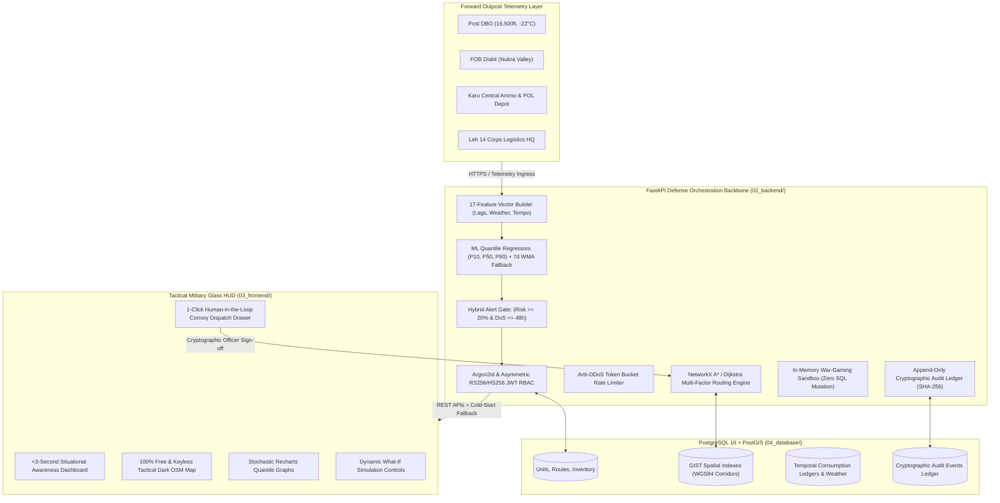

# RakshaLogix — AI-Powered Forward Defence Logistics & Sustainment Intelligence

<div align="center">


**Problem Statement ID: 26251 | Ministry of Defence & Indian Army**  
*Predictive Logistics, Threat-Resilient Supply Corridors & Sustainment Decision Support for High-Altitude Forward Outposts*

[](https://fastapi.tiangolo.com)
[](https://www.python.org)
[](https://postgis.net)
[](https://react.dev)
[](https://www.typescriptlang.org)
[](https://tailwindcss.com)
[](https://leafletjs.com)
[](https://www.docker.com)
[](LICENSE)

[Live Web Command Terminal](https://rakshalogix.vercel.app) • [Backend API Documentation](https://rakshalogix-backend.onrender.com/docs) • [Walkthrough Video Guide](03_frontend/docs/walkthrough_video_guide.md)

</div>

---

## 🎖️ Executive Summary

In high-altitude combat theaters like **Eastern Ladakh, Siachen, and Sub-Sector North (SSN)** along the strategic **Leh HQ $\rightarrow$ Daulat Beg Oldie (DBO)** axis:
* **Arctic Temperatures (-20°C to -45°C)** trigger severe, unpredictable spikes in kerosene and Arctic-grade diesel (POL) burn rates for habitat survival and generator life-support.
* **Avalanches & Sudden Mountain Pass Closures** routinely choke critical transit corridors (e.g., Khardung La, Chang La, Zoji La) without advance notice.
* **Zero-Stockout Vulnerability**: Late or miscalculated resupply convoys leave isolated forward posts defenseless against cold and isolation.

**RakshaLogix** is a high-availability tactical **Command & Control (C2) situational awareness and predictive sustainment platform**. It ingests forward outpost telemetry, runs 17-feature machine learning quantile forecasts ($P_{10}, P_{50}, P_{90}$), calculates multi-factor A* bypass routes around frozen passes, executes zero-database-mutation war-gaming simulations, and enforces strict **Human-in-the-Loop** officer dispatch sign-offs.

---

## 🏛️ End-to-End System Architecture



---

## ⚡ Core Operational Pillars & Defense Invariants

### 1. Strict Human-in-the-Loop Doctrine (Zero Autonomous Troop Orders)
* The system **never** dispatches convoys, relocates troops, or modifies ammunition manifests autonomously.
* All AI outputs are delivered as **Explainable Decision Cards** with confidence scores, underlying risk drivers, and departure windows.
* Resupply dispatches strictly require an authorized officer's cryptographic sign-off (`[Accept & Dispatch]` or `[Modify]`). Attempted automated dispatches fail with `HTTP 422`.

### 2. Multi-Horizon Quantile Demand Forecasting ($P_{10}, P_{50}, P_{90}$)
* Standard deterministic averages lead to catastrophic failures during arctic cold snaps.
* RakshaLogix calculates 24-hour, 48-hour, and 7-day quantile probabilistic trajectories:
  * **$P_{10}$**: Best-case conservation baseline.
  * **$P_{50}$**: Median expected operational demand.
  * **$P_{90}$**: Crucial worst-case cold-snap surge risk.
* **Deterministic Fallback**: If cloud connectivity drops or ML binaries are unreachable, the system falls back seamlessly to a **7-Day Weighted Moving Average (WMA)** with zero downtime.

### 3. Anti-Alarm Fatigue: Hybrid Critical Alert Gate
* Suppresses false positive notifications while ensuring imminent stockout risks are flagged:
$$\text{Stockout Risk} \ge 20\% \quad \text{AND} \quad \frac{\text{Current Usable Stock}}{\text{Predicted Demand } (P_{90})} \le 2.0 \text{ days (48 hours)}$$

### 4. Multi-Factor A* Routing with Mountain Pass Bypass Corridors
* Corridors through rugged Himalayan terrain are evaluated using an operational cost function:
$$\text{Cost} = \text{Distance (km)} + (\text{Terrain Score} \times 1.8) + (\text{Snowfall mm} \times 0.25) + (\text{Blocked Pass Penalty} \times 999)$$
* If Khardung La freezes, the system automatically plots the **Shyok-Nubra Valley bypass corridor** and calculates the exact detour delay (+4 hours 15 minutes).

### 5. Hard In-Memory War-Gaming Sandbox
* Commanders can stress-test supply chains using **Demand Multipliers (1.0x - 3.0x)**, **Snowfall Deltas**, and **Mountain Pass Cutoffs**.
* Executed via `copy.deepcopy` in-memory state replication: **zero SQL `UPDATE`, `INSERT`, or `DELETE` queries are ever run against live production tables**.

### 6. Append-Only Cryptographic Audit Ledger
* Every login, convoy authorization, alert acknowledgment, and simulation run is recorded with:
  * Dual UTC (Zulu) and Indian Standard Time (IST) timestamps.
  * Officer ID, clearance role, and client IP address.
  * **SHA-256 cryptographic signature** for tamper-evident military non-repudiation.
  * One-click CSV dossier export for official corps records.

---

## 🖥️ Tactical Command & Control Interface

| Module | Route | Operational Functionality |
| :--- | :--- | :--- |
| **Authentication Terminal** | `/login` | High-security gate with satellite link indicator, DEFCON-2 telemetry, and 1-click tactical role presets. |
| **Command Dashboard** | `/dashboard` | <3-second situational awareness, KPI status bars, AI recommendation cards, and live mini-GIS map. |
| **Forward Inventory Matrix** | `/inventory` | 8 forward posts, Days-of-Supply (DoS) runways, high-altitude indicators (16,500ft), and 14-day consumption ledgers. |
| **Quantile Forecast Explorer** | `/forecast` | Stochastic Recharts envelope ($P_{10}, P_{50}, P_{90}$), anomaly surge detectors, and horizon toggles (24h/48h/7d). |
| **GIS Tactical Corridor Map** | `/map` | 100% free, keyless OpenStreetMap with dark tactical filter, Esri satellite, and Topo basemaps without watermarks. |
| **Convoy Dispatch Hub** | `/convoys` | Asset allocation, vehicle counts (ALS Heavy Trucks / 4x4s), DEFCON priorities, and live ETA countdowns. |
| **Threat & Deficit Alerts** | `/alerts` | Severity-ranked alarms (CRITICAL, HIGH, WARNING), deduplicated alert feeds, and cryptographic acknowledgment. |
| **What-If Simulation Lab** | `/simulation` | Dynamic sliders for blizzard conditions, demand surges, and mountain pass interdictions with trajectory curves. |
| **Audit Dossier & Reports** | `/reports` | Immutable audit trail, cryptographic hash verification, and one-click exportable CSV reports. |

---

## 👥 Military Role-Based Access Control (RBAC)

Pre-configured tactical accounts for zero-friction demonstration and evaluation:

| Role Identifier | Demo Service No. / Username | Tactical Access Password | Operational Clearances |
| :--- | :--- | :--- | :--- |
| **`CORPS_COMMANDER`** | `commander_alpha` | `Commander@DefSec2026!` | Full command authorization, convoy dispatch sign-off, war-gaming simulation, and audit export. |
| **`LOGISTICS_OFFICER`** | `logistics_bravo` | `Logistics@DefSec2026!` | Stock audit, route recalculation, convoy manifest staging, and alert acknowledgment. |
| **`EDGE_READ_ONLY`** | `edge_charlie` | `EdgeReadOnly@DefSec2026!` | Forward edge post monitoring; mutating state changes strictly blocked with `HTTP 403 Forbidden`. |

---

## 📂 Repository Directory Layout

```text
RakshaLogix/
├── 02_backend/                       # FastAPI Defense Orchestration Microservice
│   ├── app/
│   │   ├── api/v1/                   # REST Routers (auth, kpi, inventory, forecast, routes, convoys, alerts, simulation)
│   │   ├── models/                   # SQLAlchemy ORM schemas (logistics, intelligence, auth, audit)
│   │   ├── security/                 # Argon2id password hashing, RS256/HS256 JWT, and RBAC guards
│   │   ├── services/                 # ML inference, A* routing heuristics, and simulation sandbox
│   │   ├── artifacts/                # Serialized Joblib ML models (demand, stockout, preprocessor)
│   │   ├── config.py                 # Pydantic v2 settings & environmental invariants
│   │   ├── database.py               # SessionLocal factory & PostGIS connection pool
│   │   └── main.py                   # FastAPI entrypoint, CORS regex, security headers, anti-DDoS
│   ├── tests/                        # 22 automated Pytest security, RBAC & pipeline integration tests
│   ├── Dockerfile                    # Hardened multi-stage non-root container configuration
│   └── requirements.txt              # Strict pinned dependency manifest
├── 03_frontend/                      # React 18 + Vite Tactical Glass HUD
│   ├── src/
│   │   ├── components/               # High-altitude badges, ServerLoader, MapResizer, Layout
│   │   ├── context/                  # AuthContext (sessionStorage + localStorage sync), ToastContext
│   │   ├── pages/                    # 9 command views (Login, Dashboard, Inventory, Forecast, Map, Convoys, etc.)
│   │   ├── services/                 # Mock telemetry fallback and client-side calculators
│   │   ├── types/                    # Strict TypeScript interfaces matching backend Pydantic schemas
│   │   ├── api.ts                    # Resilient fetch wrapper with 2.5s login & 3s API fallback timeouts
│   │   ├── index.css                 # Dark Tactical OSM tile filter, radar sweeps, and runway animations
│   │   └── main.tsx                  # Leaflet CSS inclusion & application bootstrap
│   ├── docs/                         # Walkthrough video storyboard, architecture guides & screenshots
│   ├── vercel.json                   # Single-Page Application routing rewrite rules
│   └── vite.config.ts                # Tailwind/PostCSS bundler & Render proxy configuration
└── 04_database/                      # PostgreSQL 16 + PostGIS Setup & Fixtures
    ├── 00_reset.sql                  # Schema initialization and cleanup
    ├── 01_schema.sql                 # Spatial tables, GIST indexes, and foreign keys
    ├── 02_seed_generated.sql         # 14-day historical consumption & weather logs
    ├── 03_seed_static.sql            # 8 forward posts (Leh to DBO) and mountain corridors
    └── 04_views.sql                  # Analytical materialized views for stock runway
```

---

## 🚀 Quickstart & Local Installation

### Prerequisites
* **Python**: `3.11+`
* **Node.js**: `18.x` or `20.x`
* **PostgreSQL / Docker**: Optional (system operates in high-resilience mock/in-memory mode if database is absent)

### 1. Backend Setup (`02_backend/`)
```bash
cd 02_backend
python -m venv venv
# Windows:
venv\Scripts\activate
# Linux/macOS:
source venv/bin/activate

pip install -r requirements.txt
python -m pytest tests/ -v
python -m uvicorn app.main:app --host 127.0.0.1 --port 8000 --reload
```
* Interactive API Documentation available at: `http://127.0.0.1:8000/docs`

### 2. Frontend Setup (`03_frontend/`)
```bash
cd 03_frontend
npm install
npm run build
npm run dev
```
* Tactical Web Terminal accessible at: `http://localhost:5173/`

---

## 👥 Project Team & Contributors

| Avatar | Team Member | Primary Role | Operational Responsibilities | GitHub Profile |
| :---: | :--- | :--- | :--- | :---: |
|  | **Hardik** | **Team Lead & Full-Stack Architect** | System Architecture, FastAPI Backend Orchestration, React HUD, PostGIS Integration & Deployment | [@Hardik1036](https://github.com/Hardik1036) |
|  | **Team Member 2** | **ML & Predictive Analytics Engineer** | 17-Feature Vector Pipeline, XGBoost Quantile Regressors ($P_{10}, P_{50}, P_{90}$), Anomaly Detection | [@username](https://github.com/) |
|  | **Team Member 3** | **GIS & Tactical Routing Specialist** | NetworkX A* / Dijkstra Mountain Pass Routing, PostGIS Spatial Indexing & Detour Calculation | [@username](https://github.com/) |
|  | **Team Member 4** | **UI/UX & Tactical Frontend Developer** | Military Glass HUD Components, Leaflet Map Integration, Recharts Visuals & Motion Graphics | [@username](https://github.com/) |
|  | **Team Member 5** | **Security & Defense Systems QA** | RBAC Enforcement, Cryptographic Audit Ledger, Anti-DDoS Rate Limiting & Integration Testing | [@username](https://github.com/) |

*(Team members can update their names and GitHub profile links in this section)*

---

## 📜 Intellectual Property & Defense Compliance

Developed for **Problem Statement ID: 26251 (Ministry of Defence / Indian Army)**.  
Licensed under the open-source **[MIT License](LICENSE)** for dual-use operational research and sovereign defense sustainment modernization.
